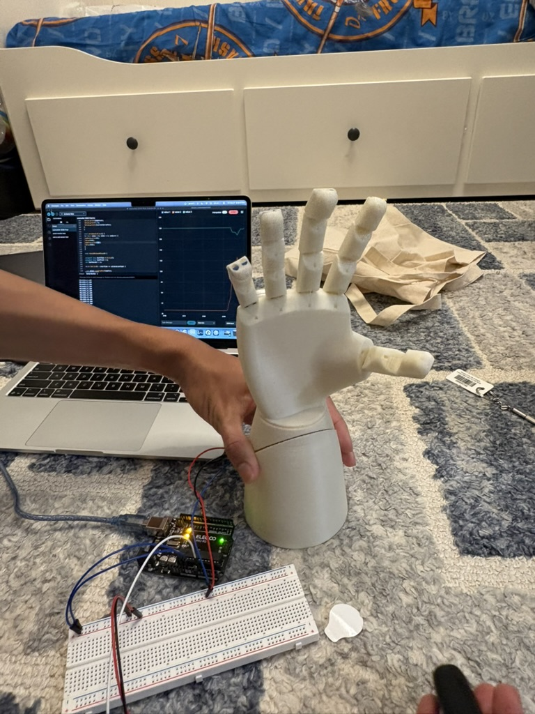
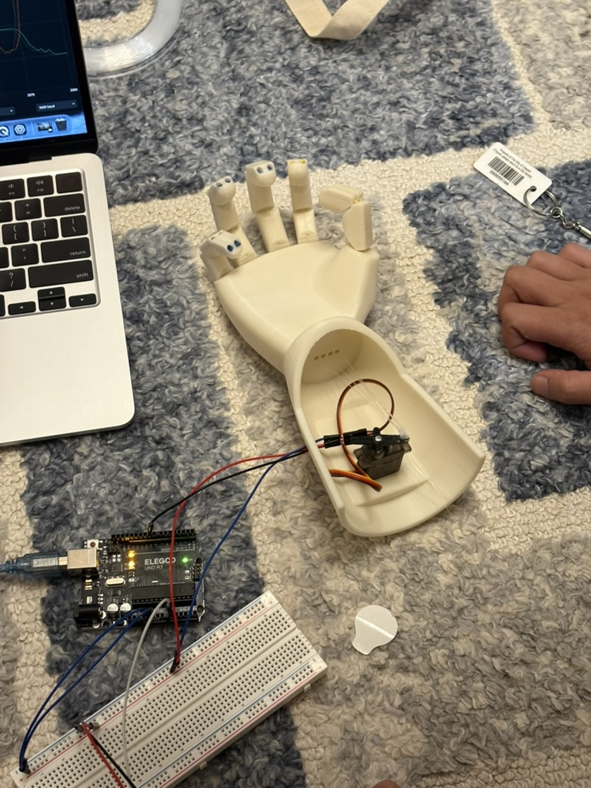
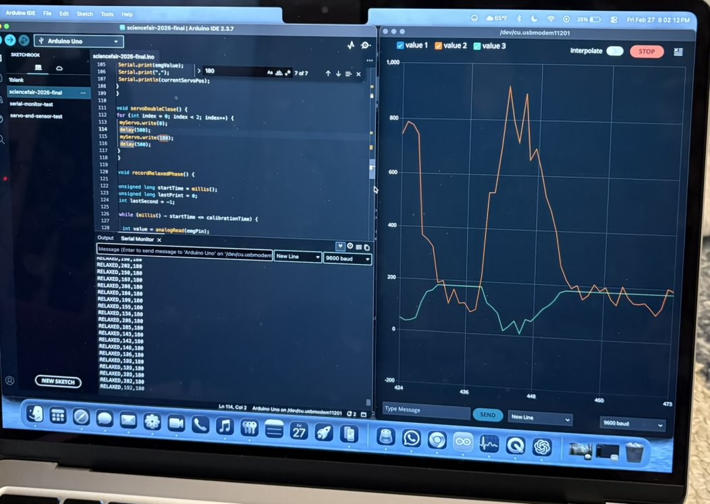
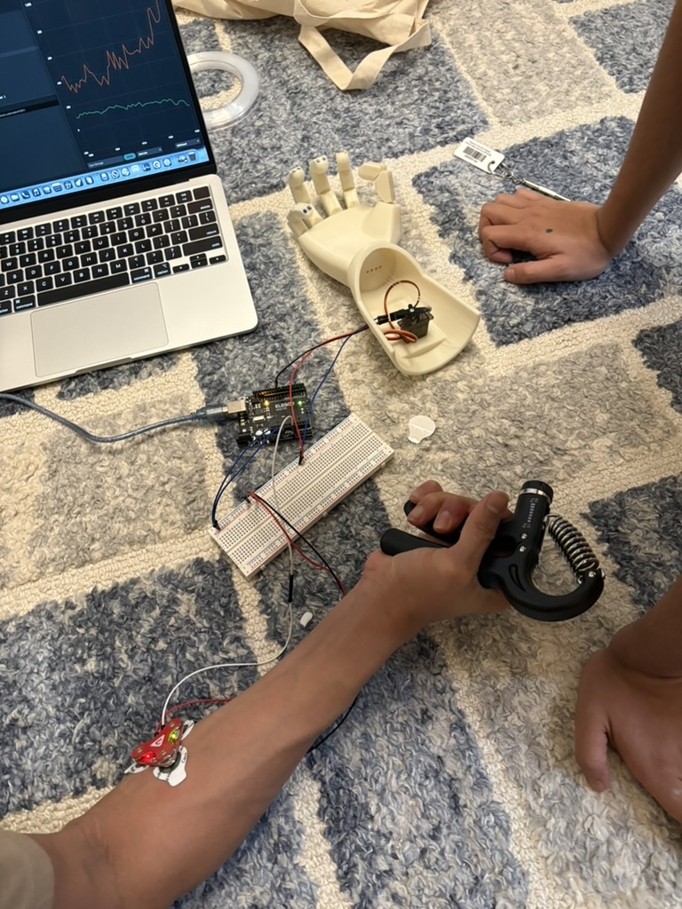
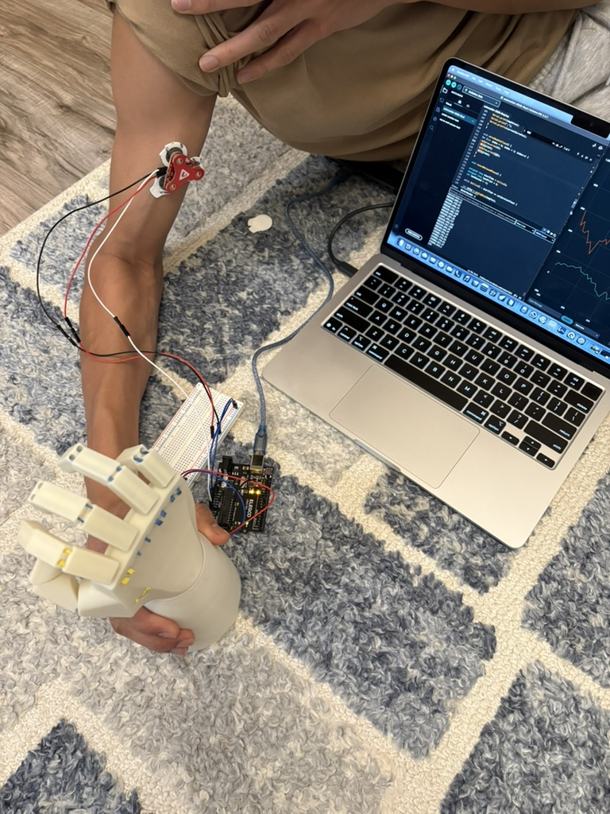

# Simulating-Electromyography-for-Bioelectronic-Control/EMG-Controlled Prosthetic Hand

Proportional control of a 3D-printed hand using muscle signals from a surface EMG sensor and an Arduino.

When you flex a muscle, it gives off a small electrical signal. This project reads that signal with a MyoWare 2.0 EMG sensor, calibrates itself to the user, and drives a servo so that the fingers bends **in proportion to how hard the muscle is flexed**. It does more than switch the fingers on or off.

<p align="center">
  
</p>

---

## Repository Structure

```
├── sciencefair-2026-final.ino   # Arduino sketch (calibration + proportional servo control)
├── hand.stl                     # 3D-printable hand model
├── Images/                      # Photos of the build and testing
└── README.md
```

---

## Why

Many low-cost assistive and prosthetic devices use buttons or switches, which feel nothing like natural movement. Surface EMG is non-invasive, reusable and cheap, so it suits affordable prosthetics. This project tests two things:

1. Can EMG signals proportionally control a servo accurately in real time?
2. How reliable is EMG control across different muscle groups (biceps, forearm, thigh)?

---

## Hardware

| Component | Notes |
|---|---|
| Arduino (Uno or compatible) | Main microcontroller |
| MyoWare 2.0 EMG sensor | Output wired to **A0** |
| Electrode pads | Placed on the center of the muscle belly, plus a reference electrode |
| Servo motor (180°) | Signal wire on **pin 9** |
| Breadboard + jumper wires | |
| 3D-printed hand ([`hand.stl`](hand.stl)) | Linked to the servo to bend the finger joints |
| Alcohol wipes | Clean the skin before placing the electrodes |

### Wiring

```
MyoWare SIG  ──► Arduino A0
MyoWare +    ──► 5V
MyoWare −    ──► GND
Servo signal ──► Arduino D9
Servo V+     ──► 5V (or an external supply)
Servo GND    ──► GND (common ground with the Arduino)
```

<p align="center">
  
  <br><em>The servo sits inside the hand's palm housing. A grip trainer gives a steady forearm contraction during testing.</em>
</p>

### 3D-Printed Hand

The hand model is included as [`hand.stl`](hand.stl). GitHub shows STL files in an interactive 3D viewer, so you can click the file to rotate and inspect it without downloading anything.

To build your own:

1. Download `hand.stl` and slice it in your slicer (Cura, PrusaSlicer, Bambu Studio, etc.).
2. Print the parts.
3. Assemble the finger joints and mount the servo inside the palm housing.
4. Connect the servo to the fingers so it pulls the fingers closed as the servo turns from 180° to 0°.

> For safety, power the Arduino from a laptop running on battery (not plugged into the wall) while electrodes are on your body.

---

## How It Works

### 1. Calibration (about 25 seconds at startup)

The servo "double-clicks" (closes and opens twice) to signal each phase:

1. **Relax phase (10 s):** records the minimum and maximum EMG values at rest.
2. **Flex phase (10 s):** records the maximum EMG value at full contraction.
3. **Threshold calculation:**

```
Noise Range        = Relaxed Max − Relaxed Min
Adaptive Threshold = Relaxed Max + 2 × Noise Range
```

The `2 × Noise Range` buffer stops resting noise and twitches from moving the fingers. Muscles with noisier baselines automatically get a larger buffer.

### 2. Live Control

Each loop:

- **Read:** averages 5 analog samples to reduce spikes.
- **Smooth:** applies an exponential moving average (`alpha = 0.1`).
- **Classify:** labels the signal as `RELAXED`, `LIGHT`, `MEDIUM` or `STRONG` (the range above the threshold is split into thirds).
- **Map:** converts the EMG value linearly to a servo angle:
  - Below the threshold → **180°** (finger open)
  - Threshold → Flex Max → **180° down to 0°** (finger closes proportionally)
- **Ramp:** moves the servo 1° per loop toward the target, so motion stays smooth.
- **Log:** prints CSV to Serial every 50 ms:

```
LEVEL,EMG,SERVO_ANGLE
RELAXED,141,180
LIGHT,312,163
...
```

Open the **Serial Plotter** in the Arduino IDE to see the EMG signal and the servo angle live.

<p align="center">
  
  <br><em>Serial Plotter: as the EMG signal (orange) spikes during a flex, the servo angle (green) drops and the hand closes.</em>
</p>

---

## Usage

1. Clone this repo and open `sciencefair-2026-final.ino` in the Arduino IDE.
2. Make sure the `Servo` library is available (it comes with the IDE).
3. Wire everything as shown above and place the electrodes on the target muscle.
4. Upload the sketch and open the Serial Monitor at **9600 baud**.
5. Follow the prompts:
   - After the first double-click → **RELAX** for 10 seconds
   - After the second double-click → **FLEX as hard as you can** for 10 seconds
6. After the third double-click, calibration is done. Flex to control the hand.

### Configurable constants

| Constant | Default | Purpose |
|---|---|---|
| `calibrationTime` | `10000` ms | Length of each calibration phase |
| `logInterval` | `50` ms | Serial output rate |
| `alpha` | `0.1` | Smoothing factor (lower = smoother but slower) |
| `emgPin` | `A0` | EMG input |
| `servoPin` | `9` | Servo output |

---

## Results

Calibration data and statistics from three muscle groups (values in ADC units, 0–1023):

<p align="center">
  
  
  <br><em>Left: forearm placement. Right: biceps placement.</em>
</p>

| Metric | Biceps | Thigh | Forearm |
|---|---|---|---|
| Relaxed Min | 124 | 27 | 112 |
| Relaxed Max | 160 | 125 | 127 |
| Noise Range | 36 | 98 | **15** |
| Adaptive Threshold | 232 | 321 | 157 |
| Flex Max | 936 | 936 | 942 |
| Usable Control Range | 704 | 615 | **785** |
| Mean Relaxed EMG | 138 | 33 | 118 |
| Std. Dev. (relaxed) | 6.2 | 3.8 | 3.9 |
| Coefficient of Variation | 4.5% | 11.5% | **3.3%** |
| Mean Strong EMG | 880 | 800 | 880 |
| Signal-to-Noise Ratio | 20.6 | 7.8 | **50.8** |
| Regression (Servo Angle =) | −0.247·EMG + 241 | −0.282·EMG + 271 | −0.224·EMG + 218 |

### Formulas

```
Usable Control Range = Flex Max − Adaptive Threshold
Coefficient of Variation = (Std. Dev. / Mean Relaxed EMG) × 100
Signal-to-Noise Ratio = (Mean Strong EMG − Mean Relaxed EMG) / Noise Range
```

### Key findings

- **The forearm was the best control site.** It had the lowest noise, the most stable baseline, the largest usable range and by far the highest SNR.
- **The thigh was the least reliable.** It had high baseline variability, which forced a higher threshold and gave the lowest SNR.
- **Control was proportional.** All three muscles showed a continuous linear relationship between EMG amplitude and servo angle, so the system works as real proportional control and not as an on/off switch.

---

## Limitations

- Surface EMG only picks up superficial muscle activity and is less precise than intramuscular EMG.
- A muscle is never fully at rest, so some baseline noise is unavoidable.
- Temperature, humidity and electrical interference can affect readings.
- Small changes in electrode placement or skin movement between trials change the signal.
- Calibration uses single raw readings, but live control uses averaged and smoothed readings, so the two are not on exactly the same scale.

---

## Future Improvements

- A servo or motor that turns past 180° for a wider, more realistic range of motion
- Multiple EMG sensors for independent finger control
- Other uses: rehabilitation tools, remote medical device control, human–computer interaction

---

## References

- Arduino. (n.d.). *Arduino Uno technical specifications.* https://www.arduino.cc/en/Main/ArduinoBoardUno
- Becerra-Fajardo, L., et al. (2024). First-in-human demonstration of floating EMG sensors and stimulators wirelessly powered and operated by volume conduction. *Journal of NeuroEngineering and Rehabilitation, 21*(4). https://jneuroengrehab.biomedcentral.com/articles/10.1186/s12984-023-01295-5
- Clancy, E. A., Morin, E. L., & Merletti, R. (2002). Sampling, noise-reduction and amplitude estimation issues in surface electromyography. *Journal of Electromyography and Kinesiology, 12*(1), 1–16. https://doi.org/10.1016/S1050-6411(01)00033-5
- Johns Hopkins Medicine. (2023). *Electromyography (EMG).* https://www.hopkinsmedicine.org/health/treatment-tests-and-therapies/electromyography-emg
- Reaz, M. B. I., Hussain, M. S., & Mohd-Yasin, F. (2006). Techniques of EMG signal analysis: Detection, processing, classification and applications. *Biological Procedures Online, 8*(1), 11–35. https://doi.org/10.1251/bpo115
- Science Buddies. (2023). *Control a motor with muscle signals (EMG).* https://www.sciencebuddies.org/science-fair-projects/project-ideas/Robotics_p070/robotics/control-motors-with-muscle-sensors
- SparkFun Electronics. (n.d.). *MyoWare muscle sensor user guide.* https://learn.sparkfun.com/tutorials/myoware-muscle-sensor
- SparkFun Electronics. (n.d.). *What is an Arduino?* https://learn.sparkfun.com/tutorials/what-is-an-arduino/all
- Tchimino, J., et al. (2024). Application of EMG feedback for hand prosthesis control in high-level amputation: A case study. *Scientific Reports.* https://www.nature.com/articles/s41598-024-80828-x

---

## Author

**Pratyush Mohanty**

> ⚠️ This is a student research project, not a medical device.
